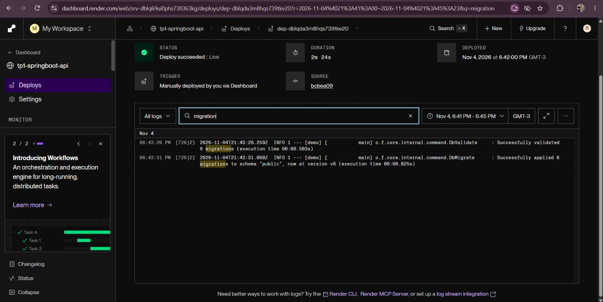
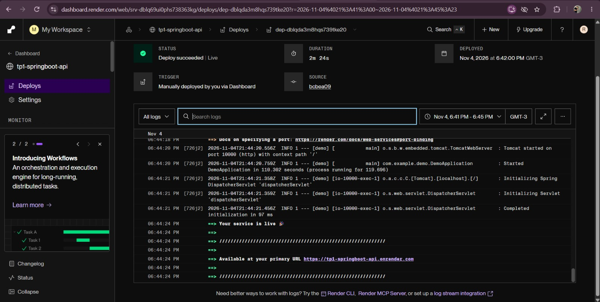
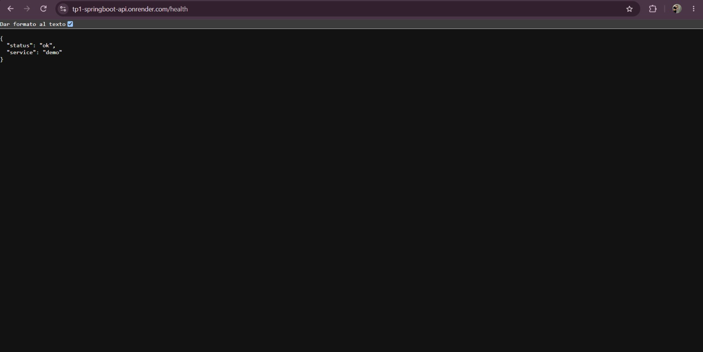
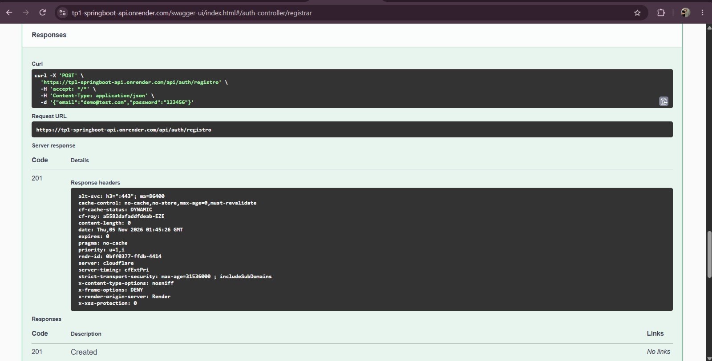
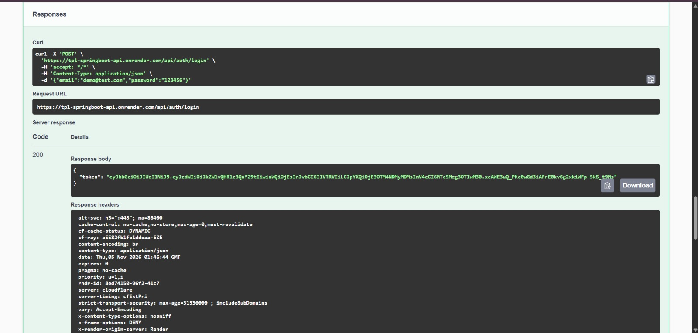
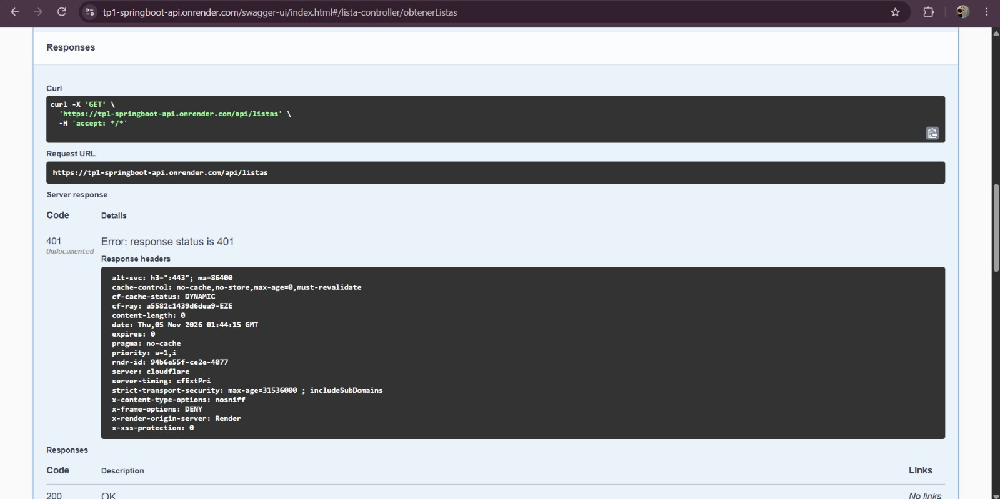
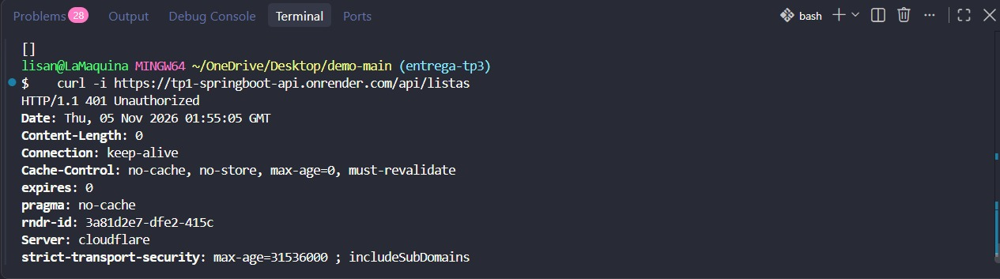
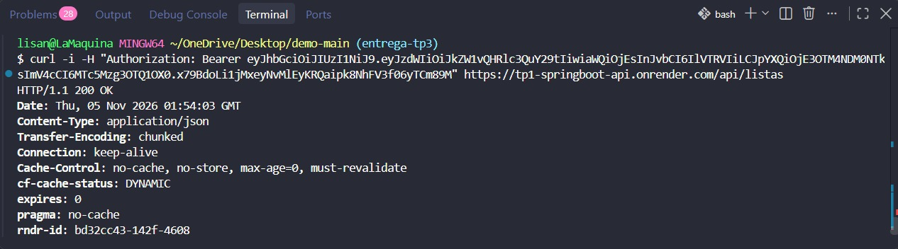
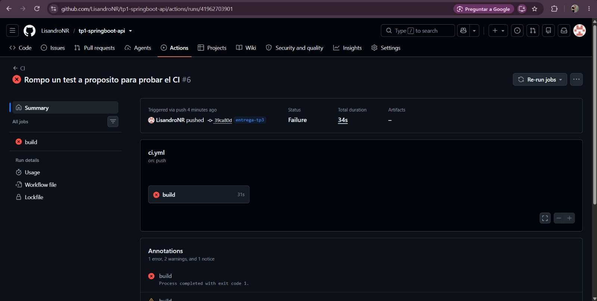
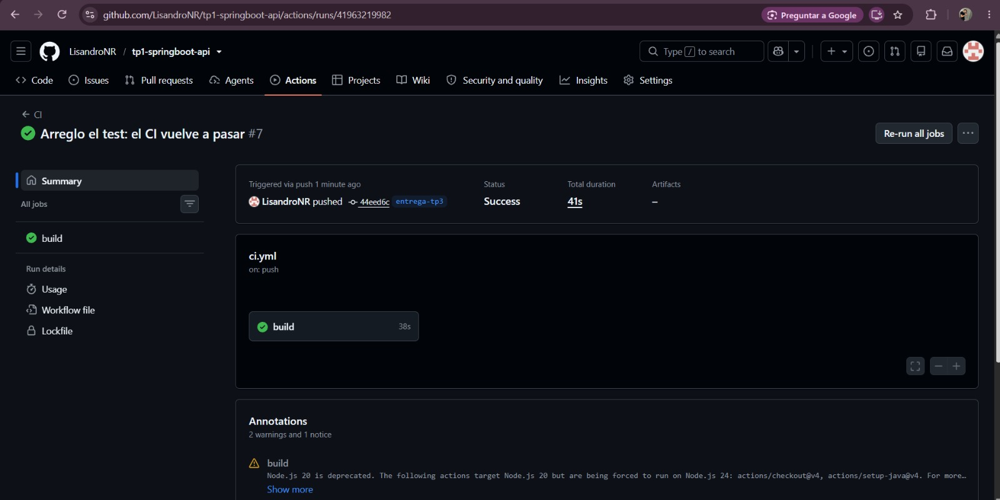

# TP3 · Seguridad, pruebas e integración continua

Repositorio de la materia Desarrollo de Aplicaciones Web II (Universidad Nacional de Villa Mercedes). Este trabajo continúa el TP2 (persistencia, migraciones y arquitectura hexagonal) y le suma autenticación con JWT, autorización por propietario y rol, pruebas automatizadas, CI y despliegue.

- **URL pública:** https://tp1-springboot-api.onrender.com
- **Swagger:** https://tp1-springboot-api.onrender.com/swagger-ui.html
- Nota: el plan gratuito de Render "duerme" por inactividad; la primera petición puede tardar cerca de un minuto.

## 🚀 Cómo levantar la base de datos y la aplicación

1. **Base de datos (PostgreSQL):** con Docker instalado, en la raíz del proyecto:
```bash
docker-compose up -d
```

2. **Migraciones (Flyway):** se ejecutan automáticamente al iniciar la aplicación.

3. **Ejecutar la aplicación:**
```bash
mvn spring-boot:run
```

Las credenciales de base y el secreto JWT se leen de variables de entorno (`DB_URL`, `DB_USER`, `DB_PASSWORD`, `JWT_SECRET`) con valores por defecto para desarrollo local.

## 🧪 Cómo correr los tests

Requisito: Docker Desktop abierto (Testcontainers levanta un PostgreSQL real).

```bash
./mvnw test      # solo unitarias (*Test, Surefire)
./mvnw verify    # unitarias + integración (*IT, Failsafe con Testcontainers)
```

Las pruebas de integración corren las migraciones de Flyway (V1 a V6) contra una base limpia en cada ejecución.

## ⚙️ Integración continua (GitHub Actions)

El workflow `.github/workflows/ci.yml` se ejecuta en cada `push`: compila el proyecto y corre `./mvnw verify`.

Cómo leer el resultado: pestaña **Actions** del repositorio → elegir la corrida.

- ✅ Verde: pasaron las pruebas unitarias y de integración.
- ❌ Rojo: abrir el job `build` y el paso con la cruz para ver qué test falló.

Corrida exitosa: [ver corrida verde en Actions](https://github.com/LisandroNR/tp1-springboot-api/actions/runs/41963219982)

## 🚀 Despliegue en Render

1. Crear una base PostgreSQL en Render (plan Free).
2. Crear un Web Service desde este repositorio, rama `entrega-tp3`, runtime Docker (usa el `Dockerfile` de la raíz).
3. Cargar las variables de entorno: `DB_URL` (formato `jdbc:postgresql://HOST:5432/BASE`), `DB_USER`, `DB_PASSWORD` y `JWT_SECRET`.
4. Configurar el Health Check Path en `/health`.
5. Verificar en los logs que Flyway aplicó las 6 migraciones y que la app arrancó sin errores.

Verificación: `GET /health` responde `{"status":"ok","service":"demo"}`; `GET /api/listas` devuelve 401 sin token y 200 con un token válido.

## 🔒 Decisiones de Seguridad (Autorización)

La validación para que un usuario solo pueda operar sobre sus propios recursos vive en la capa de **Servicio** (`ListaService`), y no en el Controller ni en anotaciones.

**Justificación:** el Controller solo se encarga de rutear las peticiones HTTP; determinar si una lista pertenece al usuario autenticado o si este tiene rol `ADMIN` es lógica de negocio. Si el servicio se invocara desde otro origen distinto de HTTP, la regla no se podría saltear por accidente.

## 📸 Evidencias del TP3

### Despliegue en Render
- Migraciones aplicadas en la base remota (Flyway, versión v6):

  

- Aplicación arrancada y servicio en línea:

  

- `GET /health` desde la URL pública:

  

### Autenticación y autorización (URL pública)
- Registro de usuario (201 Created):

  

- Login con credenciales válidas (200 con token):

  

- `/api/listas` sin token (401), desde Swagger y desde curl:

  
  

- `/api/listas` con token válido (200):

  

### Integración continua
- CI en rojo (test roto a propósito):

  

- CI en verde tras el arreglo:

  

## 📝 Decisiones de diseño del TP2

### 1. Puertos y Adaptadores (por qué el Service/Controller no se tocaron)

Durante la migración de memoria a base de datos, solo se modificaron las clases de infraestructura (repositorios JPA y Entities) y se creó un nuevo `FavoritoRepositoryAdapter`. Las clases de dominio, el `FavoritoService` y el `FavoritoController` no cambiaron en su lógica principal (salvo el campo `listaId`). Esto fue posible gracias a la Arquitectura Hexagonal: el Service depende de un Puerto (la interfaz `FavoritoRepository`) y no de una tecnología específica. Al cambiar la implementación en memoria por PostgreSQL, se conectó un nuevo Adapter detrás de la misma interfaz, manteniendo el núcleo desacoplado de la infraestructura.

### 2. Evolución del esquema (por qué no se edita V1 o V2)

Para evolucionar el esquema (por ejemplo, hacer obligatorio `lista_id` en Favoritos) se creó la migración `V4__lista_id_obligatorio.sql` en lugar de editar V1, V2 o V3 ya aplicadas. Flyway registra el checksum de cada migración en `flyway_schema_history`; si se modificara un archivo ya aplicado, detectaría el conflicto y bloquearía el arranque, garantizando la inmutabilidad y consistencia del esquema en todos los entornos. Por el mismo motivo, el TP3 agrega `V5__create_usuarios.sql` y `V6__add_usuario_id_a_listas.sql` sin tocar las anteriores.

### 3. Transacciones y propiedades ACID

En `POST /api/listas/{origenId}/mover-favoritos` se usa `@Transactional`. Sin ella, si los favoritos se reasignan pero falla el borrado de la lista original, la base quedaría inconsistente. La transacción garantiza la Atomicidad (la "A" de ACID): o se ejecutan todas las escrituras, o se revierte todo el bloque.

## 📸 Evidencias del TP2 (Swagger)

- Éxito al crear favorito (201 Created):

  

- Error 409 al borrar lista con favoritos:

  

- Éxito al mover favoritos y borrar lista (204 No Content):

  